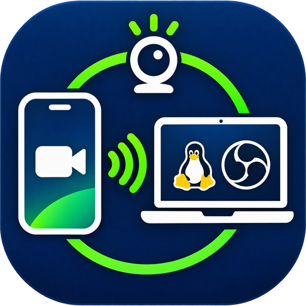

  

<h1 align="center">ConectDroidCam</h1>

Use a câmera do celular (Android ou iPhone) como webcam no computador (Linux ou macOS), por Wi-Fi ou cabo USB, para o OBS Studio e outros programas.

> **Estado:** em desenvolvimento. A câmera do celular Android já chega ao **OBS no Linux** por Wi-Fi, passando por uma webcam virtual. O app do Linux acha o celular na rede, pareia com um código de 6 dígitos, recebe o vídeo por conexão criptografada (TLS), mostra a prévia e controla o celular (resolução, FPS, câmera, iniciar e parar). Ainda **não há** áudio, USB, iPhone nem macOS. Veja o [roadmap](docs/roadmap.md).

## Como vai funcionar

1. Abra o ConectDroidCam no celular e no computador.
2. Pareie os dois confirmando um código de 6 dígitos.
3. Escolha a câmera, a resolução (HD, Full HD ou `2K (2560×1440)`) e os quadros por segundo, no celular ou no computador. O microfone entra numa versão seguinte.
4. Use a câmera no OBS ou, no Linux, como webcam de qualquer programa.

## Plataformas

| Plataforma | Papel | Observação |
|---|---|---|
| Android | Emissor (câmera) | Wi-Fi e USB |
| iOS | Emissor (câmera) | Wi-Fi e USB; sem transmissão em segundo plano |
| Linux | Receptor | Webcam virtual `v4l2loopback` e microfone virtual PipeWire |
| macOS | Receptor | Plugin para OBS; webcam do sistema depende de conta Apple Developer paga |

## Princípios

- Tudo na rede local ou por cabo: sem conta, sem nuvem, sem Internet.
- Vídeo limpo: nenhuma marca-d'água ou sobreposição na imagem entregue.
- Microfone desligado por padrão; a permissão só é pedida ao ligar.
- A resolução exibida é a que realmente chega, nunca apenas a solicitada.

## Documentação

- **Comece por aqui:** [Roadmap](docs/roadmap.md) (fases, o que já foi feito e o que falta) e [Guia de desenvolvimento](docs/desenvolvimento.md) (ambiente, como rodar tudo, convenções e armadilhas conhecidas)
- [Arquitetura](docs/arquitetura.md)
- [Protocolo v1](docs/protocol-v1.md)
- [Usar a câmera do celular no OBS](docs/usar-com-obs.md)
- [Conectar o celular pelo ADB (Linux e macOS)](docs/guia-adb.md)
- [Preparar o Mac (iOS e macOS)](docs/configurar-mac.md)
- [Resultados dos spikes da Fase 1](docs/decisoes/fase1-spikes.md)
- [Identidade visual e como refazer os ícones](docs/identidade-visual.md)
- [Especificação original](docs/especificacao-original.md) (ponto de partida; a arquitetura foi revisada)

## Desenvolvimento

Flutter (app) e Rust (protocolo e ferramentas de teste). Para montar o ambiente em qualquer máquina e saber por onde continuar, veja o [Guia de desenvolvimento](docs/desenvolvimento.md) e o [Roadmap](docs/roadmap.md).
