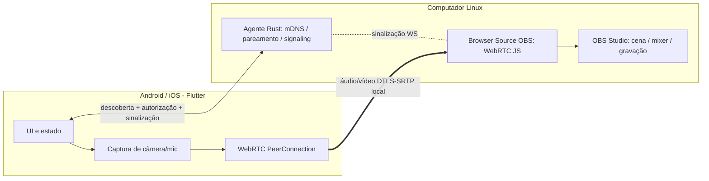
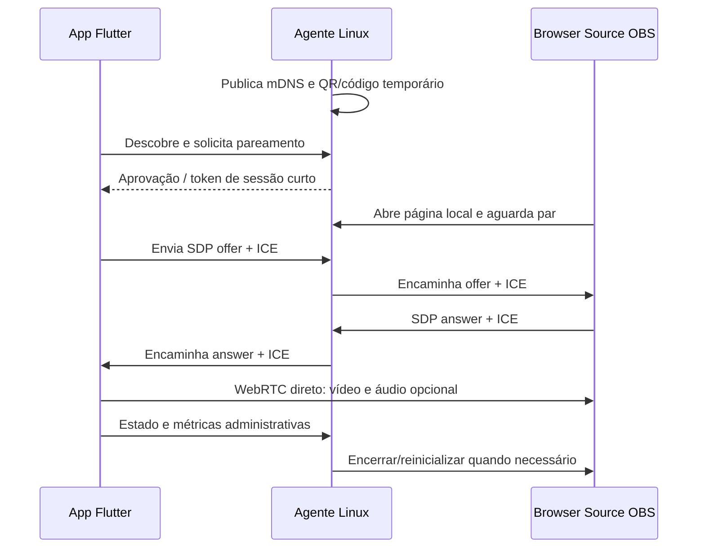

# Especificação técnica e plano de desenvolvimento — ConectDroidCam para Linux/OBS

**Documento:** PRD + arquitetura + backlog técnico + plano de validação  
**Versão:** 1.0 (proposta)  
**Data:** 09/11/2026  
**Estado:** Especificação para desenvolvimento; não é um produto já implementado.  
**Nome de trabalho:** ConectDroidCam (provisório; validar disponibilidade de marca antes da publicação).

> **Nota de revisão (09/11/2026):** esta é a especificação inicial, escrita só para Linux/OBS com WebRTC. O projeto passou a cobrir Android, iOS, Linux e macOS, com Wi-Fi e USB. Os requisitos de produto continuam valendo; a arquitetura (seções 7, 9, 10 e 13) foi substituída por um protocolo próprio sobre TLS e um núcleo Rust no desktop. Veja `docs/arquitetura.md` quando for criado.

---

## 1. Resumo executivo

Desenvolver um aplicativo Flutter para Android e iOS que utilize a câmera do smartphone como fonte de vídeo ao vivo em um computador Linux conectado à mesma rede local. A primeira entrega será otimizada para **OBS Studio**, com transmissão **sem marca-d'água**, resolução selecionável **HD (1280×720)**, **Full HD (1920×1080)** e **2K/QHD (2560×1440)** e **microfone opcional**.

A solução envolve **dois componentes**:

1. **Aplicativo móvel Flutter**: captura a câmera e o microfone (quando autorizado), codifica áudio/vídeo e envia por WebRTC.
2. **Agente Linux (processo local leve)**: disponibiliza descoberta via mDNS, pareamento, sinalização de sessões WebRTC e um endpoint local para integrar uma fonte de navegador no OBS. Na arquitetura do MVP, o agente **não recebe nem retranscodifica** a mídia: o fluxo vai do smartphone diretamente para o navegador incorporado ao OBS.

A primeira entrega **não é uma webcam global do Linux**. A modalidade de câmera virtual `/dev/video*` para Zoom, Meet e outros programas é um incremento separado, com restrições de kernel e empacotamento.

**Classificação:** aprovada com ressalvas. A viabilidade do fluxo WebRTC em *Browser Source* no OBS/Linux, com áudio e 1440p, deve ser comprovada num protótipo antes de um desenvolvimento longo.

## 2. Objetivos e não objetivos

### 2.1 Objetivos (MVP)

- Usar Android ou iPhone como câmera para o OBS de um PC Linux conectado à mesma LAN, inclusive PC em Ethernet e telefone em Wi-Fi.
- Descobrir o computador automaticamente; permitir pareamento por QR Code e conexão manual por IP/porta.
- Mostrar prévia local da câmera e controle de iniciar/parar transmissão.
- Alternar câmera traseira/frontal, quando disponível.
- Selecionar HD, Full HD ou 2K/QHD; informar o formato **realmente entregue**, não apenas o solicitado.
- Ativar/desativar a transmissão do microfone; não solicitar acesso ao microfone enquanto estiver desativado.
- Exibir imagem limpa, sem marcas, barras de status, contadores ou outros *overlays* no vídeo entregue ao OBS.
- Permitir integração manual simples por uma URL local no OBS; automatização por obs-websocket é adicional do MVP, se não ameaçar o cronograma.
- Reagir a desconexão, troca de rede, perda de permissões e redução de desempenho, com erro compreensível ao usuário.
- Funcionar inteiramente dentro da LAN, sem conta, nuvem obrigatória, assinatura ou relay público para o cenário normal.

### 2.2 Fora do MVP

- Webcam virtual global do Linux (`/dev/video*`); implementar em etapa opcional.
- Operação pela Internet ou redes diferentes com NAT/TURN.
- USB, Bluetooth, gravação no celular, múltiplos smartphones simultâneos ou controle remoto da câmera pelo OBS.
- Transmissão com tela do telefone bloqueada ou aplicativo em segundo plano, especialmente no iOS.
- 60 FPS garantidos, HDR, 4K, modo retrato com desfoque computacional, lentes específicas e controles manuais avançados de câmera.
- Suporte indistinto a **todas** as distribuições, kernels e builds de OBS sem matriz de certificação.

## 3. Premissas, limitações e decisões de produto

1. **Rede:** smartphone e Linux devem ter conectividade IP mútua na mesma rede local; estar conectado ao mesmo SSID não basta quando o roteador aplica isolamento entre clientes. Firewall e VPN também podem impedir a conexão.
2. **2K:** o botão “2K” significará **QHD 2560×1440 em 16:9**. “2K” é ambíguo na indústria (por exemplo, cinema DCI usa 2048×1080). O aplicativo exibirá explicitamente `2K (2560×1440)`.
3. **Qualidade real:** escolher uma resolução solicita um modo; a entrega depende de câmera, codificador do aparelho, codec negociado, largura de banda e renderização do OBS. Modos não suportados devem ficar indisponíveis com motivo.
4. **Resolução mínima:** não reduzir silenciosamente abaixo de **1280×720**. Se 720p não for viável, apresentar erro/alerta e interromper ou aguardar, em vez de fingir cumprir o requisito.
5. **FPS:** 30 FPS como perfil padrão para todos os modos. 60 FPS é melhoria futura condicional ao hardware.
6. **Áudio:** o microfone deve chegar ao mixer do OBS apenas quando habilitado; testar a opção “Controlar áudio pelo OBS” ou equivalente oferecida pelo build instalado.
7. **iOS:** captura de câmera normalmente sofre interrupção quando o app sai de primeiro plano; não prometer transmissão com bloqueio de tela.
8. **Compilação iOS:** o app Flutter pode ser desenvolvido majoritariamente em Linux, mas **build, assinatura e teste nativo para iPhone exigem acesso a macOS/Xcode** (físico ou ambiente CI apropriado).
9. **Privacidade:** mídia não é armazenada nem enviada para servidores externos; controle e mídia permanecem na rede local no MVP. Comunicação entre pares WebRTC usa DTLS-SRTP, mas o canal de sinalização precisa de proteção específica.

## 4. Personas e jornadas

**Usuário:** criador de conteúdo/streamer que grava ou transmite pelo OBS em Linux e prefere usar a câmera do celular.

**Jornada principal:**

1. Instala o agente Linux e abre seu painel local.
2. Confirma que o agente está “Pronto para conectar”.
3. Abre o app no celular, concede acesso à câmera e à rede local quando solicitado.
4. O app lista o Linux encontrado por mDNS; o usuário confirma o pareamento via QR Code ou código temporário.
5. Seleciona câmera, resolução e microfone ligado/desligado.
6. No OBS, adiciona uma **Fonte de navegador** com a URL fornecida pelo agente (ou utiliza a criação assistida via obs-websocket).
7. Inicia a transmissão; o preview do OBS mostra o vídeo sem marca-d'água.
8. Pode parar transmissão e desconectar do app; o OBS exibe quadro neutro ou estado “sem sinal” configurável (sem overlays quando a câmera está ativa).

**Jornada de erro:** mDNS não encontra o PC → fornecer IP/porta/QR; ICE falha → verificar firewall/isolation; perfil 1440p não é suportado → marcar perfil indisponível e oferecer Full HD.

## 5. Requisitos funcionais

| ID | Prioridade | Requisito | Critério de aceite resumido |
|---|---|---|---|
| RF-01 | P0 | Captura da câmera em Android/iOS | Preview abre com permissão e sem crash. |
| RF-02 | P0 | Transmissão em LAN | WebRTC estabelece vídeo entre móvel e OBS sem Internet. |
| RF-03 | P0 | HD 1280×720 | 720p30 validado em aparelho compatível, resolução efetiva informada. |
| RF-04 | P0 | Full HD 1920×1080 | 1080p30 disponível/validado em aparelhos de referência. |
| RF-05 | P0 | 2K/QHD 2560×1440 | 1440p30 validado em aparelho compatível; se não, indisponível explicitamente. |
| RF-06 | P0 | Microfone opcional | Sem permissão nem track quando desligado; ligado: áudio chega ao OBS. |
| RF-07 | P0 | Sem marca-d'água | Nenhuma marca ou metadado visual é desenhado sobre o vídeo. |
| RF-08 | P0 | Conectar/desconectar | Botões funcionais com estados e fechamento de recursos. |
| RF-09 | P0 | Pareamento seguro | Só receptor aprovado consome o stream; código temporário de uso único. |
| RF-10 | P0 | Fonte de navegador OBS | URL em `127.0.0.1` funciona no OBS após validação do *spike*. |
| RF-11 | P1 | Descoberta mDNS | Linux aparece automaticamente na mesma LAN sem isolamento. |
| RF-12 | P1 | Pareamento manual | Usuário pode digitar IP/porta quando mDNS não funciona. |
| RF-13 | P1 | Câmera traseira/frontal | Alternância estável quando o telefone oferecer ambas. |
| RF-14 | P1 | Estatísticas da sessão | Mostrar resolução negociada, FPS observado, bitrate e perda de pacotes. |
| RF-15 | P1 | Reconexão | Após queda breve de rede, tentar reconectar por política com backoff. |
| RF-16 | P1 | Orientação | Vídeo pode ser usado em horizontal/vertical sem distorção. |
| RF-17 | P1 | Integração opcional via obs-websocket | Criar/atualizar fonte após consentimento e autenticação do OBS. |
| RF-18 | P2 | Configuração persistida | Lembrar receptor aprovado e preferências não sensíveis. |
| RF-19 | P2 | Diagnóstico exportável | Log técnico sem mídia, credenciais ou SDP integral. |
| RF-20 | Pós-MVP | Webcam virtual do Linux | Criação opcional de dispositivo V4L2 com módulo compatível. |

### 5.1 Máquina de estados do app

`idle → discovering → pairing → paired → ready → connecting → streaming`

Desvios: `permission_denied`, `offline`, `unsupported_profile`, `reconnecting`, `error`, `stopped`.

- **`idle`**: sem câmera/microfone ativos.
- **`ready`**: prévia ativa; sessão OBS/receptor autorizada.
- **`connecting`**: negociando SDP/ICE; vídeo não deve aparecer como ativo ainda.
- **`streaming`**: ICE conectado, mídia com frames chegando; estatísticas exibidas.
- **`reconnecting`**: congelamento ou sinal perdido; backoff exponencial e timeout configurável.
- **`stopped`**: encerrar tracks, RTCPeerConnection e WebSocket quando não necessários.

## 6. Requisitos não funcionais e SLOs de validação

| ID | Requisito | Meta proposta | Como medir |
|---|---|---|---|
| RNF-01 | Latência local | Alvo: p95 ≤ 300 ms em ambiente controlado (não garantia universal) | Vídeo relógio/LED e gravação comparada à captura OBS. |
| RNF-02 | Taxa de quadros | 30 FPS alvo; mediana ≥ 27 FPS nos aparelhos de referência sem congestão | `getStats()` + captura OBS. |
| RNF-03 | Resolução | Recepção real correspondente ao perfil, quando suportado | Stats da *track* + gravação/inspeção do OBS. |
| RNF-04 | Estabilidade | Sessão de 60 min sem crash, vazamentos graves ou perda irrecuperável | Teste de resistência 3 vezes por dispositivo. |
| RNF-05 | Retomada | Reconectar após interrupção transitória em até 15 s, se rede restabelecida | Desligar/ligar Wi-Fi, reiniciar fonte OBS. |
| RNF-06 | Segurança | Sem stream sem autorização; tokens expirados não reutilizáveis | Testes negativos de pareamento/autorização. |
| RNF-07 | Offline | Não depende de serviços externos em uma LAN funcional | Desligar Internet mantendo roteador/rede. |
| RNF-08 | Térmica/bateria | Alertas claros e eventual diminuição de bitrate/FPS; sem superaquecimento ignorado | Teste de 60 min + telemetria e inspeção. |
| RNF-09 | Resiliência | Troca do modo de áudio não derruba o vídeo, sob cenários suportados | 20 alternâncias por sessão. |
| RNF-10 | Compatibilidade | Matriz com versão de kernel, OBS e pacote | Testes reais em distros definidas. |

**Metas não são fatos medidos.** p95, bitrate, 2K e estabilidade são critérios propostos para o produto e exigem validação no hardware real.

### 6.1 Perfis de mídia iniciais

| Perfil | Dimensão nominal | FPS alvo | Faixa inicial de bitrate de vídeo (ajustável) |
|---|---|---|---|
| HD | 1280×720 | 30 | 2–4 Mb/s |
| Full HD | 1920×1080 | 30 | 4–8 Mb/s |
| 2K / QHD | 2560×1440 | 30 | 6–12 Mb/s |

Estas faixas são **valores de projeto para ensaio**, não mínimos obrigatórios nem garantia de qualidade. Definir codec prioritário H.264, negociando capacidades entre smartphone e navegador OBS; manter fallback compatível (por exemplo VP8) após teste. Preferir *hardware encoding* onde o plugin/plataforma permitirem. Áudio Opus mono, alvo 48 kHz quando negociado, com taxa adaptativa apropriada a voz.

**Política de adaptação:** permitir redução de bitrate e FPS; se mudar resolução, manter ≥720p e indicar o valor efetivo. Se o usuário bloquear um perfil, avisar que poderá ocorrer travamento sob rede fraca.

## 7. Desenho de arquitetura



### 7.1 Justificativa das escolhas

- **Flutter:** uma interface móvel compartilhada, com wrappers nativos para câmera e permissões.
- **`flutter_webrtc`:** captura e transmissão em Android/iOS, com controles de transceivers e ICE.
- **Rust + Tokio + Axum:** agente local de baixa sobrecarga; web server/WS/estados e painel leve, sem necessitar ambiente Node instalado no computador do usuário. Alternativa válida: Go.
- **mDNS/Bonjour:** descoberta dentro da LAN com fallback manual. Nome de serviço proposto: `_conectdroidcam._tcp.local`.
- **OBS Browser Source:** integração inicial sem instalar kernel modules ou driver virtual; *HTML/JavaScript* implementa outro endpoint WebRTC.
- **obs-websocket 5.x (opcional):** criação automática da fonte quando o usuário autorizar o acesso ao OBS.

**Ponto de risco técnico:** a funcionalidade WebRTC/CEF, decodificação 1440p e áudio em um Browser Source de Linux varia conforme distribuição/pacote. **Executar o spike da seção 15 antes de assumir o fluxo como concluído**. Caso falhe, a alternativa será desenvolver um receptor GStreamer/FFmpeg com saída para fonte OBS validada, recalculando escopo e prazo.

### 7.2 Fluxo de conexão e mídia



### 7.3 Agente Linux

**Módulos internos:** `discovery`, `pairing`, `auth`, `sessions`, `signaling`, `local_web`, `obs_integration`, `diagnostics`, `config`.

**Listeners propostos (configuráveis):**

- `0.0.0.0:47821` ou interface LAN explícita: sinalização e pareamento para o app móvel, protegidos por token e validação de origem; jamais expor na Internet.
- `127.0.0.1:47822`: painel local e página `/obs/<sessionId>` usada pela Fonte de navegador. Nunca escutar esse painel em todas as interfaces por padrão.
- OBS obs-websocket: normalmente `127.0.0.1:4455`, apenas se habilitado e autenticado pelo usuário.

**Descoberta:** mDNS com TXT mínimo `version`, `name`, `pairing_available`; não divulgar tokens no broadcast. Quando mDNS não estiver disponível, suportar IP/porta preenchidos manualmente.

**Pareamento:** QR/código aleatório temporário, uso único, expiração sugerida de 2 min e rate limiting. Registrar autorização de receptor em armazenamento local do telefone (Keystore/Keychain); permitir revogação nos dois lados.

**Sessões:** inicialmente uma sessão móvel ativa por fonte; o agente liga cada sessão aprovada a uma fonte OBS local. Não permitir que clientes desconhecidos se conectem ao canal de mídia.

**Empacotamento:** primeiro um binário Linux com painel web local e instalação controlada; depois pacotes `.deb`, `.rpm` e opção AppImage, testados separadamente. “Qualquer distro” deve ser entendido como meta de portabilidade, não promessa de suporte universal.

### 7.4 OBS Studio

**Integração manual do MVP:**

1. Agente apresenta uma URL do tipo `http://127.0.0.1:47822/obs/<session-id>`.
2. No OBS: **Fontes → + → Fonte de navegador → URL**.
3. Ajustar largura/altura da fonte conforme o perfil (720p, 1080p ou 1440p); usar uma página responsiva com `object-fit: contain` ou `cover` configurável.
4. Testar explicitamente **áudio controlado pelo OBS** e a presença do volume no mixer, conforme recursos do build.
5. Deixar desligados quaisquer elementos gráficos sobre a imagem publicada; diagnóstico permanece somente no app/painel.

**Integração assistida (P1):** opcionalmente conectar ao obs-websocket com senha fornecida pelo usuário, listar cenas, criar/atualizar fonte `browser_source`, redimensionar corretamente e permitir desfazer a operação. Não alterar cenas sem autorização explícita.

**Importante:** uma fonte 1440p pode ser reduzida pelo canvas e pela saída OBS em 1080p. Para uma gravação final 1440p, ajustar também as configurações de vídeo do OBS.

## 8. Aplicativo móvel: UX e componentes

### 8.1 Telas

1. **Boas-vindas/Permissões:** finalidade de câmera/rede local e microfone apenas quando ativado.
2. **Computadores encontrados:** nome do host, presença do agente, ação `Conectar`, campo `Inserir IP`, scanner QR.
3. **Pareamento:** nome do computador, verificação do QR/código, autorizar e revogar.
4. **Câmera e transmissão:** preview, câmera frontal/traseira, seleção de resolução, microfone ON/OFF, botão `Iniciar transmissão`, status de latência/FPS/qualidade.
5. **Diagnóstico:** estado ICE/DTLS, codec, resolução capturada/recebida, perda de pacotes, bitrate, mensagens de erro com ações.
6. **Configurações:** política de reconexão, modo de ajuste de resolução (`contain`/`cover`), dispositivos confiáveis, informações de privacidade.

**Proposta visual resumida:** preview domina a tela, com pequena barra inferior de controles. Painéis de controle **não entram no fluxo de pixels**; são widgets sobrepostos apenas na UI do telefone.

### 8.2 Organização Flutter (feature-first + Clean Architecture leve)

```text
mobile/
  lib/
    app/                   # Router, tema, inicialização/DI
    core/
      errors/              # Erros tipados
      permissions/         # Gate de câmera, mic e LAN
      storage/             # Preferences e credenciais seguras
      telemetry/           # Logs/estatísticas sem PII
    features/
      discovery/
        data/ domain/ presentation/
      pairing/
        data/ domain/ presentation/
      camera/
        data/ domain/ presentation/
      streaming/
        data/ domain/ presentation/
      settings/
        data/ domain/ presentation/
    shared/widgets/
  test/
  integration_test/
  android/
  ios/
```

**Gerenciamento de estado:** Riverpod ou Bloc; escolher **um**. Sugestão: Riverpod com providers para `CameraController`, `DiscoveryRepository`, `SignalingClient`, `StreamingSessionController`. `go_router` para navegação; `flutter_secure_storage` para segredo de pareamento, sujeito a validação das versões vigentes.

**Contratos Dart sugeridos:**

```dart
abstract interface class DeviceDiscoveryRepository {
  Stream<List<ReceiverDevice>> discover();
  Future<ReceiverDevice> connectManually(String host, int port);
}

abstract interface class PairingRepository {
  Future<PairingResult> pair(ReceiverDevice receiver, String oneTimeCode);
  Future<void> revoke(String receiverId);
}

abstract interface class CameraStreamingRepository {
  Future<List<VideoProfile>> supportedProfiles();
  Future<void> start({required VideoProfile profile, required bool microphone});
  Future<void> setMicrophoneEnabled(bool enabled);
  Future<void> switchCamera();
  Stream<StreamMetrics> watchMetrics();
  Future<void> stop();
}
```

Os tipos são **especificações de interface**, não implementações completas.

## 9. Captura, codecs e áudio

### 9.1 Captura

- Usar `navigator.mediaDevices.getUserMedia` do `flutter_webrtc` com *constraints* de largura, altura e frameRate.
- Consultar capacidades/perfis reais por dispositivo; validar o que foi entregue via *track settings* e stats. Não assumir que solicitar 2560×1440 garante saída 2560×1440.
- Preferir câmera traseira ao iniciar; alternar frontal se solicitada.
- Trocar resolução com reinicialização/renegociação apenas quando necessário; bloquear interações duplicadas.
- Reconhecer rotação e *aspect ratio*; preservar proporção, oferecendo corte (`cover`) apenas por escolha do usuário.
- Enquanto ativo, impedir suspensão automática da tela **quando possível e permitido**, com controle claro de consumo de energia.
- Em interrupção de câmera ou temperatura crítica, atualizar estado e interromper/recomeçar de maneira segura.

**Exemplo conceitual de constraints:**

```dart
final constraints = {
  'audio': false, // Mudar só após permissão e escolha do usuário
  'video': {
    'facingMode': 'environment',
    'width': 1920,
    'height': 1080,
    'frameRate': 30,
  },
};

final stream = await navigator.mediaDevices.getUserMedia(constraints);
```

### 9.2 Microfone ON/OFF

- Estado inicial configurável; padrão recomendado: **desativado**.
- `OFF`: não capturar áudio nem manter track de microfone ativa. Se existia uma track, removê-la, pará-la e renegociar a conexão quando necessário.
- `ON`: solicitar permissão do sistema nessa hora, criar track de áudio, anexar à conexão e renegociar sem interromper o vídeo. Tratar negação de permissão sem travar.
- No OBS, evitar que o próprio áudio do PC seja reproduzido e recapturado, prevenindo realimentação.
- Definir regra explícita para saída local: o app móvel **não** precisa reproduzir seu próprio áudio.
- Ajustar sincronização de A/V e aplicar filtros (AGC, cancelamento de eco e supressão de ruído) apenas se não prejudicarem a captação pretendida.

### 9.3 ICE, codecs e ajustes

- `RTCPeerConnection` com candidatos ICE de interface local; sem STUN/TURN obrigatório na LAN. Implementar negociação de SDP, ICE trickle e detecção de perda de conexão.
- Negociar H.264 preferencialmente, com fallback habilitado após teste real de interoperabilidade; **não forçar perfil/codec que o OBS não decodifica**.
- Usar estimativa de bitrate e RTP sender parameters onde houver suporte no plugin.
- Calibrar jitter buffer para latência/estabilidade. Evitar buffers arbitrariamente grandes.
- Estado `connected` não basta: verificar **frames recebidos** na fonte OBS.

## 10. Protocolo entre app, agente e fonte OBS

**Versão:** `protocolVersion: 1`. Mensagens JSON via WebSocket para sinalização; validar esquema, autenticação, tamanho, timeout e versão.

```json
{
  "protocolVersion": 1,
  "type": "webrtc.offer",
  "sessionId": "<uuid>",
  "requestId": "<uuid>",
  "payload": { "sdp": "<session-description>" }
}
```

**Tipos propostos:** `device.hello`, `pair.request`, `pair.accepted`, `pair.denied`, `session.create`, `session.ready`, `webrtc.offer`, `webrtc.answer`, `webrtc.ice`, `media.profile.request`, `media.profile.actual`, `audio.state`, `session.stop`, `session.error`, `heartbeat`.

**Erros tipados:** `PERMISSION_DENIED_CAMERA`, `PERMISSION_DENIED_MIC`, `LAN_PERMISSION_DENIED`, `RECEIVER_NOT_FOUND`, `PAIRING_EXPIRED`, `AUTH_FAILED`, `OBS_SOURCE_NOT_READY`, `ICE_FAILED`, `UNSUPPORTED_RESOLUTION`, `CODEC_INCOMPATIBLE`, `VIDEO_FRAMES_NOT_RECEIVED`, `NETWORK_INTERRUPTED`, `THERMAL_LIMIT`.

**Regras:**

- Payload de SDP/ICE só circula em sessão autorizada e só entre peers associados à sessão.
- Rate-limit de solicitações de pairing e WebSocket.
- Mensagens com `sessionId` desconhecido ou sem autenticação são rejeitadas.
- `session.stop` precisa apagar recursos no agente, no smartphone e na fonte browser.
- Expiração de sessões e códigos sem atividade.
- Identificadores de sessão não devem funcionar como acesso irrestrito ao app ou câmera.

## 11. Permissões e segurança

### 11.1 Android

- `INTERNET`, `CAMERA`; `RECORD_AUDIO` somente para habilitar o microfone.
- Verificar permissões de descoberta/rede conforme SDK e abordagem. Em **Android 17 / target SDK 37+**, acesso à LAN passa a exigir `ACCESS_LOCAL_NETWORK` em runtime; implementar tratamento de recusa. Documentação recente do Flutter descreve `Permission.accessLocalNetwork.request()`.
- Não usar permissões de localização/Bluetooth sem necessidade comprovada.
- Restringir tráfego local inseguro conforme as APIs utilizadas; **não** habilitar cleartext global sem justificativa.

### 11.2 iOS

- `NSCameraUsageDescription`, `NSMicrophoneUsageDescription`, `NSLocalNetworkUsageDescription`, e `NSBonjourServices` para o tipo de serviço anunciado/descoberto.
- Configurar App Transport Security (`NSAllowsLocalNetworking` quando aplicável) e validar conexão a hostname `.local` e IP manual na versão alvo do iOS.
- Conferir prompts e estados recusados em dispositivo físico.
- A câmera pode ser interrompida ao ir para segundo plano; informar isso na UI. Não utilizar artifícios para contornar restrições do sistema.

### 11.3 Modelo de ameaça resumido

| Ameaça | Controle |
|---|---|
| Terceiro descobre receptor na LAN e tenta assistir | Pareamento obrigatório, sessão autorizada, credenciais com expiração e revogação. |
| Vazamento do QR/código | Código aleatório de uso único e TTL curto; exibir receptor antes de confirmar. |
| Ataque de repetição | Nonce/requestId e validade limitada; rejeição de token revogado. |
| Escuta da mídia | DTLS-SRTP WebRTC; validar fingerprint/ciclo SDP. |
| Leitura de sinalização | Priorizar transporte de sinalização autenticado e protegido; evitar WS claro em redes não confiáveis. |
| Exposição do agente na Internet | Bind e firewall para LAN; rejeitar interfaces públicas por padrão; não configurar port forwarding. |
| Logs sensíveis | Nunca salvar frames, microfone, tokens ou SDP completos. |
| Controle indevido do OBS | obs-websocket somente com autenticação, endereço loopback e permissão expressa. |

**Nota:** DTLS-SRTP cifra mídia, **não** cifra automaticamente o canal de sinalização. Para distribuição pública, concluir threat modeling, revisar ATS/cleartext e adotar sinalização com TLS/autenticação e gestão confiável de chaves/certificados, ou validar formalmente um modelo de risco estritamente local.

## 12. Compatibilidade Linux

### 12.1 Suporte inicial de referência

Testar ao menos:

- Ubuntu LTS ou derivado baseado em Debian: ambiente X11 e Wayland quando disponíveis.
- Fedora Workstation: Wayland.
- Arch Linux ou derivado rolling release: ambiente gráfico típico.

Após testes, registrar **versão exata** de distribuição, kernel, OBS, origem do pacote OBS (repositório/Flatpak etc.), versão do agente e resultado do Browser Source. Para Debian, Mint, openSUSE e outros, adicionar matriz progressivamente; não rotular todos como “certificados” sem execução real.

### 12.2 Matriz de aceitação

| Cenário | Ubuntu/Debian | Fedora | Arch |
|---|---|---|---|
| Descoberta mDNS | Testar | Testar | Testar |
| Conexão manual por IP | Testar | Testar | Testar |
| OBS Browser Source com WebRTC | Testar | Testar | Testar |
| Áudio no mixer do OBS | Testar | Testar | Testar |
| Full HD/2K | Testar | Testar | Testar |
| Firewall/pacote Flatpak | Testar | Testar | Testar |

### 12.3 Câmera virtual Linux (pós-MVP)

Se precisar que a imagem apareça como *webcam* em outros aplicativos, avaliar `v4l2loopback` e um decodificador que receba WebRTC e escreva frames formatados em `/dev/video*` (por exemplo, GStreamer `v4l2sink`). Isso **não decorre automaticamente** da implementação Browser Source.

A instalação pode exigir privilégios administrativos, módulo DKMS, cabeçalhos de kernel e assinatura sob Secure Boot. Testar diferenças de pacotes e atualizações de kernel. Para essa função, projetar processo separado de recepção/decodificação, que eleva CPU/memória e custo de manutenção. O OBS poderá usar **Dispositivo de Captura de Vídeo (V4L2)** nesse modo.

## 13. Estrutura do repositório

```text
conectdroidcam/
  README.md
  LICENSE
  docs/
    architecture.md
    protocol-v1.md
    security.md
    acceptance-matrix.md
    release.md
  mobile/                        # Flutter Android + iOS
    lib/
    test/
    integration_test/
    android/
    ios/
  linux-agent/                   # Rust
    Cargo.toml
    src/
      main.rs
      discovery/
      pairing/
      signaling/
      sessions/
      web/
      obs/
      config/
    tests/
  obs-web/                       # HTML/TypeScript sem dependências remotas
    src/
      webrtc.ts
      signaling.ts
      media.ts
      stats.ts
    tests/
  packaging/
    deb/
    rpm/
    appimage/
  scripts/
  .github/workflows/
```

**Controle de versão:** Git; `main` protegida; PR com revisão; *semantic versioning* do protocolo e artefatos. CI: análise Flutter, testes unitários, `cargo test`, lint TypeScript, builds smoke, SAST/dependency audit e geração de pacotes.

## 14. Backlog de implementação por épicos (checklist)

### EP-00 — Prova de conceito e decisões (P0)

- [ ] Criar protótipo Flutter mínimo com `flutter_webrtc` no Android.
- [ ] Criar página HTML/JS local com `RTCPeerConnection` a ser adicionada ao OBS.
- [ ] Implementar sinalização mínima (manual ou WebSocket) no Linux.
- [ ] Transmitir vídeo 720p no OBS e medir atraso.
- [ ] Validar iPhone físico com macOS/Xcode.
- [ ] Validar áudio recebido e controlável no mixer do OBS.
- [ ] Testar H.264/VP8 nos builds de OBS escolhidos.
- [ ] Testar 1080p e 1440p nos aparelhos de referência.
- [ ] Decidir `go/no-go` para Browser Source; registrar fallback necessário.

### EP-01 — Fundação e engenharia (P0)

- [ ] Estruturar monorepo, padrões de código, branches e CI.
- [ ] Definir `protocol-v1` e validação de mensagens.
- [ ] Definir estados, erros e contratos mobile/agente/browser.
- [ ] Adicionar testes unitários mínimos e logs protegidos.
- [ ] Criar configuração inicial e builds de desenvolvimento.

### EP-02 — Captura móvel (P0)

- [ ] Implementar permissão de câmera e UI de preview.
- [ ] Implementar perfis 720p/1080p/1440p e detecção de suporte.
- [ ] Alternar câmera frontal/traseira.
- [ ] Implementar orientação, proporção e reconstrução segura do stream.
- [ ] Criar controles e feedback de erro para bateria/temperatura/interrupções.
- [ ] Impedir suspensão de tela enquanto necessário e permitido.

### EP-03 — Agente Linux (P0)

- [ ] Criar serviço HTTP/WS local e na interface LAN.
- [ ] Implementar descoberta mDNS/Bonjour e conexão manual.
- [ ] Criar pareamento QR/código temporário, autenticação e revogação.
- [ ] Gerenciar sessões e encaminhar SDP/ICE.
- [ ] Publicar página local `/obs/...` e painel de estado.
- [ ] Garantir encerramento/limpeza de sessões e portas.

### EP-04 — WebRTC e OBS (P0)

- [ ] Implementar oferta/resposta SDP e ICE trickle.
- [ ] Conectar celular diretamente ao Browser Source.
- [ ] Mostrar vídeo sem sobreposição e com aspect ratio correto.
- [ ] Testar fonte oculta, troca de cena e recarregamento de Browser Source.
- [ ] Exibir estatísticas de frames reais e perdas.
- [ ] Aplicar reconexão e recuperação quando fonte OBS reinicializa.
- [ ] Documentar instrução manual de fonte no OBS.

### EP-05 — Áudio opcional (P0)

- [ ] Manter microfone OFF por padrão, sem solicitar permissão.
- [ ] Solicitar autorização apenas ao ligar.
- [ ] Adicionar/remover track com renegociação segura.
- [ ] Testar sincronização A/V, eco, interrupções e mixer OBS.
- [ ] Implementar sinalização de recusa e estado efetivo de mic.

### EP-06 — Robustez e segurança (P0)

- [ ] Validar limites de mensagem, TTL, replay, rate limiting e revogação.
- [ ] Revisar comunicação de sinalização/ATS e superfície LAN.
- [ ] Testar rede guest/isolation, firewall, Wi-Fi 2,4 GHz e 5 GHz.
- [ ] Medir latência p50/p95, CPU, perda e consumo energético.
- [ ] Fazer testes de 60 minutos e matriz de dispositivos.
- [ ] Confirmar 2K em hardware compatível e fallback explícito.
- [ ] Testar Android 17 (target SDK 37+) e permissões LAN.
- [ ] Testar iOS físico com permissões/foreground.

### EP-07 — Distribuição e documentação (P1)

- [ ] Gerar APK/AAB de teste e build de iOS assinado.
- [ ] Entregar binário do agente e instaladores `.deb` e `.rpm` testados.
- [ ] Criar guia de firewall/portas e troubleshooting.
- [ ] Documentar suporte por distro/build do OBS.
- [ ] Documentar política de privacidade e requisitos de publicação.
- [ ] Criar release com notas, checksums e procedimento de atualização.

### EP-08 — Melhorias futuras (P2)

- [ ] Assistente para criar fonte pelo obs-websocket.
- [ ] Webcam V4L2 (`v4l2loopback`) com receptor nativo.
- [ ] Múltiplas fontes, presets de qualidade e 60 FPS suportados.
- [ ] Transmissão via USB/Internet mediante nova arquitetura e modelagem de segurança.

## 15. Plano de execução, duração e gates

Estimativas para **um desenvolvedor familiarizado com Flutter**, adquirindo conhecimento de WebRTC e Rust/OBS durante a execução; variam fortemente com hardware, bugs do navegador OBS e disponibilidade de Mac/iPhone.

| Etapa | Entrega verificável | Estimativa |
|---|---|---:|
| 0 — Spike | WebRTC Android/iPhone → Browser Source OBS, áudio, perfis e latência | 12–20 h |
| 1 — Fundação | Monorepo, contrato, estado, CI e testes básicos | 16–28 h |
| 2 — Mobile | Preview, perfis, câmera, UI, permissões | 32–55 h |
| 3 — Agente | Rust web/WS, mDNS, QR/pairing, sessões | 25–45 h |
| 4 — OBS/WebRTC | Página Browser Source, SDP/ICE, métricas, falhas | 20–40 h |
| 5 — Áudio | Habilitação dinâmica do mic, mixer e sync | 10–22 h |
| 6 — QA/hardening | Segurança, conectividade, compatibilidade, endurance | 30–50 h |
| 7 — Distribuição | Pacotes, documentação e release de testes | 15–25 h |
| **Total estimado (MVP)** | **Sem câmera virtual global** | **160–285 h** |

Em dedicação de **20 horas por semana**, são aproximadamente **8–15 semanas**, sem incluir atrasos de compra/acesso a iPhone/Mac, review de lojas e mudança de arquitetura. Webcam virtual global acrescentará esforço substancial, a estimar após o MVP.

### Critérios de passagem (gates)

**Gate G0 — Arquitetura:** vídeo 720p e áudio opcional no Browser Source Linux, com teste em Android **e** iPhone; medir performance. Se falhar, não desenvolver UI e empacotamento sobre premissa não validada.

**Gate G1 — Vertical slice:** celular conectado a agente com pareamento; vídeo 1080p OBS; iniciar/parar controlado.

**Gate G2 — Qualidade:** 720p/1080p/1440p oferecidos corretamente; 1440p funcional em aparelhos compatíveis; áudio ON/OFF seguro; sem marca-d'água.

**Gate G3 — Release de teste:** rede sem Internet, reconexão, permissões, teste 60 min e matriz mínima de Linux aprovada; vulnerabilidades críticas resolvidas.

## 16. Plano de testes

### 16.1 Dispositivos e combinações

- Android intermediário com suporte de hardware a 1080p, Android premium com câmera/codificador aptos a QHD, iPhone físico compatível; selecionar modelos exatos antes de fixar taxa de cobertura.
- Em Linux: 3 distros base (Ubuntu/Fedora/Arch), Wayland e X11 conforme disponível, OBS de repositório e Flatpak quando pertinentes.
- Redes: Wi-Fi 2,4 GHz, 5 GHz, roteador sem Internet, computador em Ethernet, VPN habilitada/desabilitada, isolamento entre clientes.
- Estado físico: telefone em modo retrato e paisagem, carregando, bateria baixa, tela desbloqueada, chamadas/notificações, temperatura elevada.

### 16.2 Casos de teste indispensáveis

| Caso | Ação | Resultado esperado |
|---|---|---|
| CT-001 | Abrir app sem permissão de câmera | Exibir solicitação/explicação; não transmitir imagem. |
| CT-002 | Parear por QR válido | Receptor confiável e sessão criada. |
| CT-003 | Reutilizar QR expirado | Autorização recusada. |
| CT-004 | Iniciar 720p30 | OBS mostra ≥720p efetivo em cenário compatível. |
| CT-005 | Solicitar Full HD | 1920×1080 efetivo ou explicação verificável de incompatibilidade. |
| CT-006 | Solicitar 2K/QHD | 2560×1440 efetivo em dispositivo certificado; sem falsa indicação. |
| CT-007 | Microfone OFF desde o início | Nenhuma permissão ou track do microfone em uso. |
| CT-008 | Ativar microfone | Solicita permissão e áudio entra no mixer sem perder vídeo. |
| CT-009 | Desativar microfone | Captura de áudio encerrada; mixer deixa de receber sinal. |
| CT-010 | Remover Wi-Fi 5 s e restaurar | Recupera sessão ou mostra erro com retomada, sem crash. |
| CT-011 | Ocultar e mostrar fonte OBS | Reconexão/renderização correta. |
| CT-012 | Iniciar sem Internet WAN | Funciona em LAN. |
| CT-013 | Ativar isolamento de clientes | Falha diagnosticada, não fica carregando indefinidamente. |
| CT-014 | Trocar frente/trás | Mídia continua ou renegocia de forma controlada. |
| CT-015 | Sessão 60 minutos | Sem crash, vazamento grave ou degradação térmica ignorada. |
| CT-016 | Gravar vídeo OBS | Frame final sem logo, texto ou marca d'água. |
| CT-017 | Encerrar/app em segundo plano iOS | Tratamento explícito de interrupção da captura. |
| CT-018 | Android 17 com LAN negada | Mensagem e fluxo para solicitar/acessar configurações. |
| CT-019 | Cliente não pareado tentando stream | Acesso negado. |
| CT-020 | OBS com canvas 1080p e câmera 1440p | UI informa diferença entre entrada e saída; sem alegação de gravação QHD. |

### 16.3 Métricas e observabilidade

- `framesEncoded`, `framesDecoded`, `framesDropped`, `framesPerSecond`, resolução enviada/recebida, bitrate em envio, perda de pacotes, jitter, round trip time (RTT), state ICE, codec negociado.
- Latência ponta-a-ponta: utilizar referência visual com relógio/LED de transição rápida e sincronizar registros de captura e OBS; não tratar RTT de rede como latência total de vídeo.
- Definir amostra de teste e percentil (p50/p95) antes de anunciar resultados.

## 17. Riscos, opções e contrapontos

| Risco | Impacto | Mitigação/condição |
|---|---|---|
| WebRTC não funciona de maneira confiável no CEF/OBS Linux | Bloqueador da arquitetura | Spike G0; fallback receptor nativo (GStreamer) com novo esforço. |
| iPhone sem Mac para build/assinatura | Bloqueio da entrega iOS | Garantir acesso a Mac/Xcode desde o início. |
| Câmera/encoder não entrega 1440p em tempo real | 2K indisponível em parte da base | Testar aparelhos, exibir limitações reais, usar 1080p quando necessário. |
| Rede instável/interferência Wi-Fi | Queda de frames/latência | Medir perdas, adaptar bitrate/FPS, recomendar 5 GHz. |
| Browser Source do OBS com áudio não controlável em algum pacote | Falha de requisito de áudio | Testes por distribuição; fallback nativo/alternativa de saída validada. |
| Sinalização local insegura | Exposição de sessão a dispositivos maliciosos da LAN | Autenticação forte, consentimento, TLS e threat model. |
| Excesso de promessas “qualquer distro” | Retrabalho e suporte indefinido | Publicar matriz de distros/builds testados e requisitos. |
| iOS suspende câmera em background | Stream interrompido | Avisar, manter tela ativa quando possível, tratar callbacks. |
| Webcam virtual adicionada cedo | Kernel/DKMS/Secure Boot aumentam complexidade | Separar do MVP OBS. |

**Alternativa A — escolhida:** WebRTC direto ao Browser Source + agente leve. Menor complexidade de instalação Linux e menor acoplamento com kernel. Exige validação de CEF e áudio.

**Alternativa B — fallback técnico:** WebRTC → receptor nativo Linux (GStreamer/FFmpeg ou stack equivalente) → fonte OBS por saída validada, aumentando processamento, dependências e teste. Só adotar se A falhar ou houver demanda expressa por webcam virtual global.

**Alternativa C — RTSP/SRT direto:** pode simplificar ingestão no OBS em certos ambientes, mas exige implementação nativa/servidor de streaming, compatibilidade de áudio, tratamento de buffers e testes de latência. Não é automaticamente superior a WebRTC.

## 18. Critério de pronto / Definition of Done

- [ ] Android e iPhone físicos demonstram streaming com o mesmo projeto Flutter.
- [ ] Linux com agente local permite parear e integrar ao OBS.
- [ ] Sem conta, servidor remoto ou Internet obrigatórios na LAN.
- [ ] 720p e 1080p validados em aparelhos de referência; 1440p validado em aparelho apto, com detecção de incompatibilidade nos demais.
- [ ] Microfone começa desativado e pode ser ativado/desativado sem reiniciar a sessão em cenário suportado.
- [ ] OBS recebe áudio e vídeo com sincronização aceitável.
- [ ] O conteúdo enviado não possui marca-d'água nem controles visuais.
- [ ] Permissões e segurança de pareamento testadas; mídia não persiste em disco por padrão.
- [ ] A matriz Linux/OBS documenta ambientes testados e limitações.
- [ ] Logs, instruções de instalação, resolução de problemas e testes automatizados foram entregues.
- [ ] As métricas de qualidade publicadas têm base em medições reais, não apenas estimativas.

## 19. Passos imediatos recomendados

1. Selecionar **um Android, um iPhone e um Linux/OBS** de teste. Garantir acesso a um Mac/Xcode para o iPhone.
2. Executar **somente o spike G0**: Flutter WebRTC → página Browser Source OBS, 720p + áudio; confirmar compatibilidade e medir atraso.
3. Expandir spike para 1080p/1440p e registrar qual codec, modo e taxa de frames realmente funcionam.
4. Com G0 aprovado, implementar agente de pareamento e a interface do aplicativo; só então investir em empacotamento e recursos complementares.
5. Avaliar câmera virtual `/dev/video*` como uma **versão 2**, se o uso fora do OBS se tornar requisito.

---

## 20. Referências técnicas verificadas

Consulta realizada em 09/11/2026; versões de bibliotecas e SDKs devem ser revalidadas na implementação.

1. Flutter WebRTC package: https://pub.dev/packages/flutter_webrtc
2. Flutter WebRTC / getUserMedia: https://flutter-webrtc.org/docs/flutter-webrtc/api-docs/get-user-media/
3. Flutter WebRTC / RTCPeerConnection: https://flutter-webrtc.org/docs/flutter-webrtc/api-docs/rtc-peerconnection/
4. OBS Browser Source: https://obsproject.com/kb/browser-source
5. OBS Video Capture Sources (V4L2): https://obsproject.com/kb/video-capture-sources/
6. OBS Remote Control / obs-websocket: https://obsproject.com/kb/remote-control-guide
7. v4l2loopback README: https://github.com/v4l2loopback/v4l2loopback/blob/main/README.md
8. WebRTC peer connection + ICE: https://webrtc.org/getting-started/peer-connections
9. Flutter / Android local network permission: https://docs.flutter.dev/platform-integration/android/local-network-permission
10. Android local network permission: https://developer.android.com/privacy-and-security/local-network-permission
11. Apple NSLocalNetworkUsageDescription: https://developer.apple.com/documentation/BundleResources/Information-Property-List/NSLocalNetworkUsageDescription
12. Apple NSAllowsLocalNetworking (ATS): https://developer.apple.com/documentation/bundleresources/information-property-list/nsapptransportsecurity/nsallowslocalnetworking
13. Apple camera background interruption: https://developer.apple.com/documentation/AVFoundation/AVCaptureSession/InterruptionReason/videoDeviceNotAvailableInBackground
14. Flutter iOS build requirements: https://docs.flutter.dev/platform-integration/ios/setup

**Decisão arquitetural final:** começar com o caminho mais curto que atinge o objetivo real (fonte OBS), sem adicionar webcam virtual de kernel no primeiro ciclo; validar iOS, CEF, áudio e 1440p antes de assumir disponibilidade geral.
